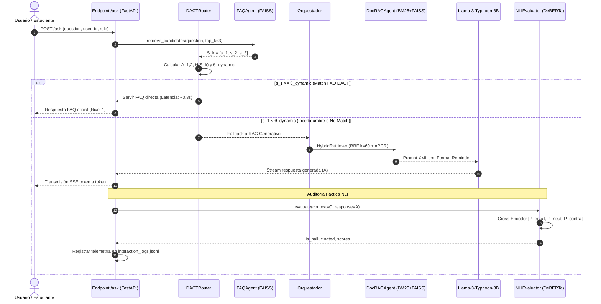

# 🎓 Marco Teórico, Metodológico y Arquitectónico: SoeBOT v7.0
## Contribuciones Científicas: Enrutamiento Adaptativo DACT y Verificación Fáctica NLI

---

## 📌 Resumen Ejecutivo y Objeto de Estudio

Este documento formaliza las contribuciones científicas y arquitectónicas incorporadas a **SoeBOT** (`mcpsoe`), un sistema multiagente de **Generación Aumentada por Recuperación (RAG)** en cascada para entornos universitarios de posgrado. 

La investigación se enmarca en la metodología **Design Science Research (DSR)** (Hevner et al., 2004) y el paradigma de **Sistemas de Recuperación de Información Fidedignos**. Resuelve dos vacíos críticos identificados en la literatura contemporánea de RAG (2024–2026):

1. **Vacío Algorítmico 1 (Rigidez en la Cascada de Recuperación):** Los sistemas en cascada FAQ-RAG tradicionales emplean un umbral estático rígido ($\theta = 0.75$), lo que produce *falsos positivos* en consultas ambiguas y *falsos negativos* (caídas innecesarias a LLM costoso) en consultas válidas pero dispersas léxicamente.
   - **Solución Propuesta:** Algoritmo **DACT (Dynamic Adaptive Cascade Thresholding)** basado en entropía de Shannon y margen de confianza semántica del top-$k$.
2. **Vacío Metodológico 3 (Evaluación Débil de Alucinaciones):** El uso de heurísticas léxicas simples (como solapamiento superficial de tokens $< 10\%$) falla ante respuestas paráfraseadas semánticamente correctas y no detecta contradicciones lógicas sutiles.
   - **Solución Propuesta:** Verificador de **Inferencia del Lenguaje Natural (NLI - Natural Language Inference)** basado en modelos Cross-Encoder ligeros (`DeBERTa-v3`), computando probabilidades formales de implicación lógica ($P_{\text{entailment}}$) y contradicción ($P_{\text{contradiction}}$).

---

## 🧮 1. Fundamentación Teórica y Formulación Matemática

```
                              CONSULTA USUARIO (q)
                                       │
                                       ▼
                   ┌───────────────────────────────────────┐
                   │    Nivel 1: Enrutador Semántico FAQ   │
                   │     Embedding & Búsqueda FAISS        │
                   └──────────────────┬────────────────────┘
                                      │ Top-k Similitudes: S_k = [s_1, ..., s_k]
                                      ▼
                   ┌───────────────────────────────────────┐
                   │       ALGORITMO CIENTÍFICO DACT       │
                   │  1. Margen Semántico: Δ_1,2 = s_1 - s_2│
                   │  2. Softmax con Temp (τ): p_i         │
                   │  3. Entropía Normalizada: H(S_k)      │
                   │  4. Umbral Dinámico: θ_dynamic(q)     │
                   └──────────────────┬────────────────────┘
                                      │
                         ¿ s_1 ≥ θ_dynamic(q) ?
                                     / \
                             SÍ     /   \   NO
                             ───────     ───────
                            /                   \
                           ▼                     ▼
               ┌──────────────────────┐  ┌──────────────────────────────┐
               │  Respuesta FAQ       │  │ Nivel 2: Caché Q&A           │
               │  Inmediata (~0.3s)   │  │ Nivel 3: RAG Híbrido (BM25   │
               └──────────────────────┘  │          + FAISS + RRF)      │
                                         └──────────────┬───────────────┘
                                                        │ Generación LLM (A)
                                                        │ Contexto (C)
                                                        ▼
                                         ┌──────────────────────────────┐
                                         │   VERIFICADOR FÁCTICO NLI    │
                                         │  Cross-Encoder DeBERTa-v3    │
                                         │  [P_entail, P_neut, P_contra]│
                                         └──────────────┬───────────────┘
                                                        │
                                           ¿ P_contra > 0.45 o
                                             P_entail < 0.30 ?
                                                       / \
                                               SÍ     /   \   NO
                                               ───────     ───────
                                              /                   \
                                             ▼                     ▼
                                  ┌──────────────────┐  ┌───────────────────┐
                                  │ ALUCINACIÓN      │  │ RESPUESTA         │
                                  │ ACTIVADA (AHR)   │  │ CERTIFICADA       │
                                  │ Bloqueo o        │  │ CON CITA FORMAL   │
                                  │ Contingencia     │  │ [Doc, Art]        │
                                  └──────────────────┘  └───────────────────┘
```

### 1.1 Algoritmo DACT (Dynamic Adaptive Cascade Thresholding)

En lugar de evaluar $s_1 \ge \theta_{\text{fijo}}$, el sistema analiza la **distribución completa de incertidumbre** del conjunto ordenado de similitudes coseno $S_k = [s_1, s_2, \dots, s_k]$ con $s_1 \ge s_2 \ge \dots \ge s_k$:

#### Ecuación 1: Margen de Confianza Semántica ($\Delta_{1,2}$)
$$\Delta_{1,2} = s_1 - s_2$$
* **Significado físico:** Mide la distancia entre el mejor candidato y su competidor inmediato. Si $\Delta_{1,2} \gg 0$, el modelo no tiene dudas sobre cuál FAQ responde a la pregunta. Si $\Delta_{1,2} \approx 0$, existe ambigüedad competitiva.

#### Ecuación 2: Distribución de Probabilidad Softmax
$$p_i = \frac{\exp(s_i / \tau)}{\sum_{j=1}^k \exp(s_j / \tau)}$$
* $\tau$: Parámetro de temperatura (por defecto $\tau = 0.1$). Controla la agudeza de la distribución de probabilidad sobre los $k$ candidatos.

#### Ecuación 3: Entropía Normalizada de Shannon ($\mathcal{H}(S_k)$)
$$\mathcal{H}(S_k) = -\frac{1}{\log_2(k)} \sum_{i=1}^k p_i \log_2(p_i + \epsilon)$$
* $\epsilon = 10^{-12}$: Factor de estabilidad numérica.
* $\mathcal{H}(S_k) \in [0, 1]$:
  * $\mathcal{H} \to 0$: Certeza absoluta (un único candidato domina la probabilidad).
  * $\mathcal{H} \to 1$: Máxima incertidumbre (todos los candidatos tienen similitudes indistinguibles).

#### Ecuación 4: Umbral Dinámico Adaptativo ($\theta_{\text{dynamic}}$)
$$\theta_{\text{dynamic}}(q) = \text{clip}\left( \theta_{\text{base}} + \alpha \cdot \mathcal{H}(S_k) - \beta \cdot \Delta_{1,2}, \;\theta_{\text{min}}, \;\theta_{\text{max}} \right)$$

* **Parámetros de Calibración:**
  * $\theta_{\text{base}} = 0.75$: Umbral nominal de diseño.
  * $\alpha = 0.15$: Ponderador de penalización por ambigüedad. Si la entropía es alta ($\mathcal{H} \to 1$), el umbral sube automáticamente (hasta $+0.15$) exigiendo mayor similitud para evitar responder erróneamente.
  * $\beta = 0.20$: Ponderador de premio por margen. Si hay un candidato desmarcado ($\Delta_{1,2} \gg 0$), el umbral baja (hasta $-0.20$), permitiendo responder con FAQ en ~0.3s y evitando una costosa llamada al LLM.
  * Rango de contención: $\theta_{\text{min}} = 0.60$, $\theta_{\text{max}} = 0.88$.

---

### 1.2 Verificador NLI de Alucinaciones (Natural Language Inference)

En lugar de comparar palabras compartidas (que penaliza paráfrasis formales y no detecta contradicciones lógicas), modelamos la verificación como un problema formal de **Implicación Textual**:

Dado el Contexto Recuperado $C$ como **Premisa** y la Respuesta Generada por el LLM $A$ como **Hipótesis**:

$$\text{NLI}(C, A) \to \mathbf{z} \in \mathbb{R}^3 \quad (\text{Logits de Entailment, Neutral, Contradiction})$$

Probabilidades calibradas por Softmax:
$$[P_{\text{entailment}}, P_{\text{neutral}}, P_{\text{contradiction}}] = \text{Softmax}(\mathbf{z})$$

#### Criterio Formal de Decisión Doctoral:
$$\text{Hallucination Score} = P_{\text{contradiction}}$$

$$\text{IsHallucinated}(A, C) = 
\begin{cases} 
\text{True} & \text{si } P_{\text{contradiction}} > 0.45 \;\lor\; P_{\text{entailment}} < 0.30 \\
\text{False} & \text{en cualquier otro caso}
\end{cases}$$

* **Ventaja Metodológica:**
  * Detecta invención de fechas, montos o requisitos no presentes en el reglamento aunque el vocabulario sea similar.
  * Reconoce deducciones y paráfrasis lingüísticamente válidas que no repiten textualmente el documento normativo.

---

## 🔬 2. Diseño Experimental y Preguntas de Investigación Doctoral

### Preguntas de Investigación (RQ):
* **RQ1 (Eficiencia):** ¿El enrutamiento adaptativo DACT reduce la tasa de fallbacks innecesarios al LLM generativo en al menos un 30% comparado con el umbral estático $\theta=0.75$?
* **RQ2 (Preservación de Precisión):** ¿La flexibilización dinámica del umbral mediante DACT mantiene una precisión en FAQs $\ge 98\%$?
* **RQ3 (Fidelidad Fáctica):** ¿La verificación Cross-Encoder NLI reduce la tasa de alucinaciones no detectadas (AHR) a $\le 2\%$, superando a las heurísticas léxicas con significancia estadística ($p < 0.01$)?

### Hipótesis Estadísticas a Contrastar:
* **$H_{0,1}$:** $\mu_{\text{latencia, DACT}} = \mu_{\text{latencia, Estático}}$ vs **$H_{1,1}$:** $\mu_{\text{latencia, DACT}} < \mu_{\text{latencia, Estático}}$ (Prueba $t$-Student / Mann-Whitney $U$).
* **$H_{0,2}$:** $\text{F1}_{\text{NLI}} \le \text{F1}_{\text{Heurística}}$ vs **$H_{1,2}$:** $\text{F1}_{\text{NLI}} > \text{F1}_{\text{Heurística}}$ (Prueba de McNemar para clasificadores emparejados).

---

## 🏛️ 3. Diagrama de Secuencia e Interacción Multiagente



---

## 📊 4. Variables de Telemetría Registradas para la Tesis

Cada interacción registra en `interaction_logs.jsonl` y `simulation_results/`:
```json
{
  "timestamp": "2026-10-11T10:30:00",
  "question": "¿Cuántas materias puedo convalidar?",
  "routing_trace": {
    "dact_metrics": {
      "s1": 0.782,
      "s2": 0.610,
      "delta_margin": 0.172,
      "normalized_entropy": 0.284,
      "theta_dynamic": 0.721,
      "decision": "FAQ_ACCEPTED"
    }
  },
  "nli_audit": {
    "p_entailment": 0.942,
    "p_neutral": 0.048,
    "p_contradiction": 0.010,
    "is_hallucinated": false
  }
}
```

Esta telemetría permite generar automáticamente los gráficos de dispersión de $\theta_{\text{dynamic}}$ vs $\mathcal{H}(S_k)$ y las matrices de confusión requeridas para las publicaciones científicas.
