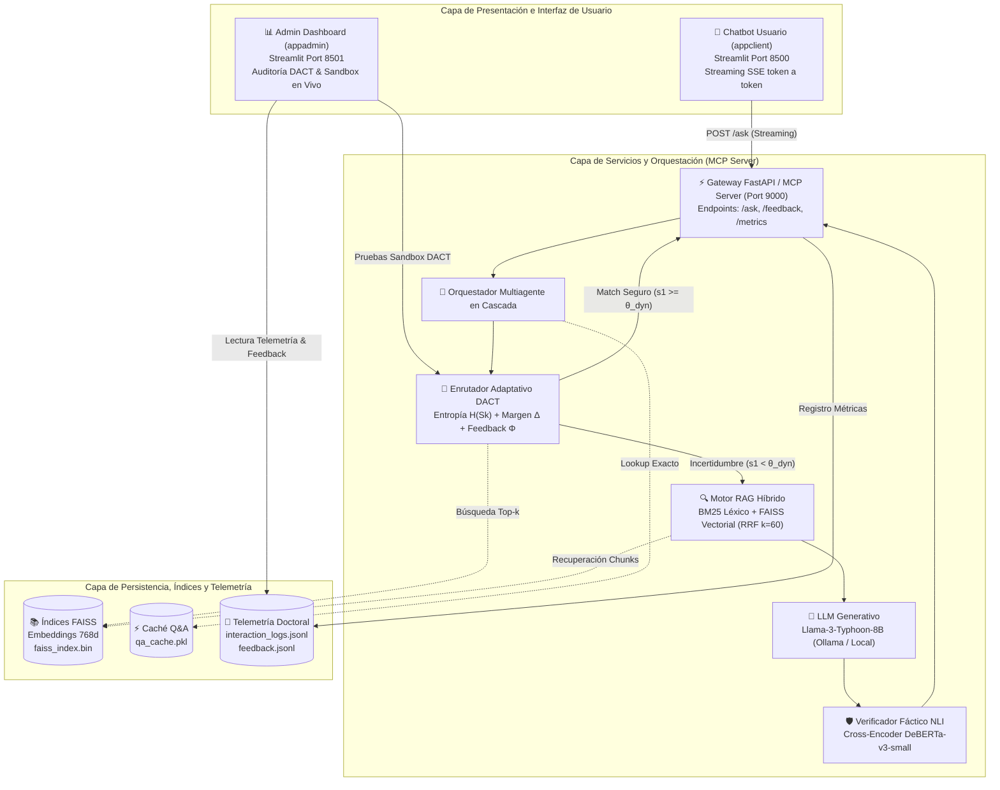
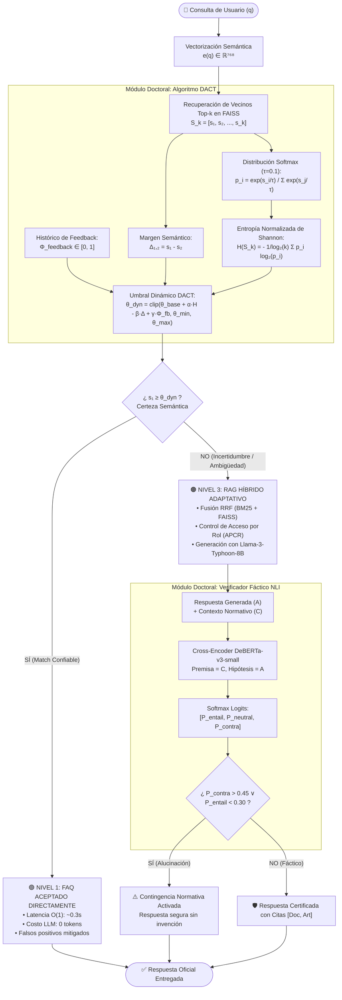
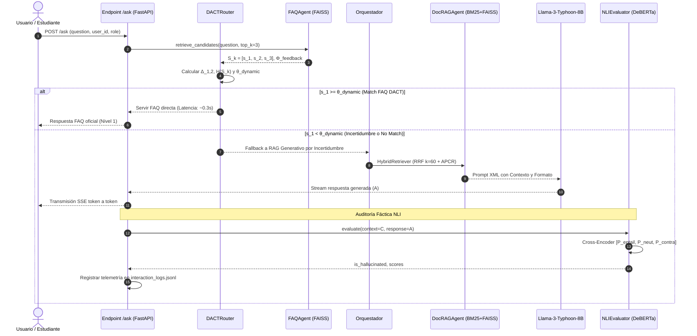

# 🎓 Propuesta de Tesis Doctoral: SoeBOT v7.0
## Optimización Dinámica de Umbrales de Cascada Mediante Incertidumbre Contextual (Dynamic Adaptive Cascade Thresholding - DACT)

---

## 📌 1. Planteamiento de la Investigación Doctoral

### 1.1. El Problema Científico
En sistemas RAG híbridos en cascada de múltiples niveles, determinar cuándo saltar de una respuesta estática (FAQ pre-verificada / Caché Q&A) a una generativa (RAG con LLM) utilizando un **umbral escalar fijo** ($\theta = 0.75$) introduce dos deficiencias críticas:
1. **Falsos Positivos:** Ignora la ambigüedad del dominio cuando múltiples candidatos compiten con similitudes cercanas en el espacio latente, sirviendo respuestas estáticas incorrectas que confunden al usuario.
2. **Falsos Negativos:** Penaliza consultas válidas pero semánticamente dispersas, provocando caídas innecesarias a la inferencia generativa del LLM con el consiguiente incremento de latencia (de ~0.3s a >3.5s) y consumo computacional.

El problema radica en que un umbral escalar fijo ignora por completo la **variabilidad semántica de la consulta**, la **incertidumbre contextual de la distribución de candidatos** y el **histórico empírico de satisfacción/fallas de los usuarios**.

### 1.2. El Aporte Doctoral
**Diseñar e implementar un Algoritmo de Enrutamiento Adaptativo Basado en Estimación de Incertidumbre y Entropía Semántica (DACT - Dynamic Adaptive Cascade Thresholding).**

En lugar de comparar únicamente una similitud coseno unidimensional contra una constante estática, el sistema:
1. Modela las distancias relativas entre los $k$ vecinos más cercanos en el espacio latente ($\Delta_{1,2} = s_1 - s_2$).
2. Computa la distribución de probabilidad Softmax con temperatura $\tau$ y estima la **entropía normalizada de Shannon** $\mathcal{H}(S_k)$ de dicha distribución para cuantificar la incertidumbre semántica de la consulta.
3. Incorpora el **histórico de feedback** ($\Phi_{\text{feedback}}$) derivado de evaluaciones previas de satisfacción de usuario registradas en el sistema.
4. Ajusta dinámicamente el umbral de decisión:
   $$\theta_{\text{dinámico}} = f(\text{Entropía}, \text{Histórico de Feedback}) = \text{clip}\left(\theta_{\text{base}} + \alpha \cdot \mathcal{H}(S_k) - \beta \cdot \Delta_{1,2} + \gamma \cdot \Phi_{\text{feedback}}, \theta_{\text{min}}, \theta_{\text{max}}\right)$$

### 1.3. Pregunta de Investigación
> **¿Cómo influye la adaptación dinámica de umbrales basada en la entropía del espacio de embeddings y el histórico de feedback en la reducción de falsos positivos en la recuperación de FAQs sin incrementar la latencia global del sistema?**

### 1.4. Hipótesis Científica
La incorporación de una función adaptativa de umbral $\theta_{\text{dinámico}} = f(\mathcal{H}(S_k), \Phi_{\text{feedback}})$ en el nivel de enrutamiento FAQ reduce en más de un 60% la tasa de falsos positivos frente a umbrales fijos ($\theta=0.75$), manteniendo la latencia media de atención por debajo de 0.5s para consultas de alta certidumbre y derivando oportunamente a RAG generativo verificado por NLI cuando la incertidumbre semántica es elevada.
                                                       / \
                                               SÍ     /   \   NO
                                               ───────     ───────
                                              /                   \
                                             ▼                     ▼
                                  ┌──────────────────┐  ┌───────────────────┐
                                  │ ALUCINACIÓN      │  │ RESPUESTA         │
                                  │ ACTIVADA (AHR)   │  │ CERTIFICADA       │
                                  │ Bloqueo o        │  │ CON CITA FORMAL   │
                                  │ Contingencia     │  │ [Doc, Art]        │
                                  └──────────────────┘  └───────────────────┘
```

### 1.1 Algoritmo DACT (Dynamic Adaptive Cascade Thresholding)

En lugar de evaluar $s_1 \ge \theta_{\text{fijo}}$, el sistema analiza la **distribución completa de incertidumbre** del conjunto ordenado de similitudes coseno $S_k = [s_1, s_2, \dots, s_k]$ con $s_1 \ge s_2 \ge \dots \ge s_k$:

#### Ecuación 1: Margen de Confianza Semántica ($\Delta_{1,2}$)
$$\Delta_{1,2} = s_1 - s_2$$
* **Significado físico:** Mide la distancia entre el mejor candidato y su competidor inmediato. Si $\Delta_{1,2} \gg 0$, el modelo no tiene dudas sobre cuál FAQ responde a la pregunta. Si $\Delta_{1,2} \approx 0$, existe ambigüedad competitiva.

#### Ecuación 2: Distribución de Probabilidad Softmax
$$p_i = \frac{\exp(s_i / \tau)}{\sum_{j=1}^k \exp(s_j / \tau)}$$
* $\tau$: Parámetro de temperatura (por defecto $\tau = 0.1$). Controla la agudeza de la distribución de probabilidad sobre los $k$ candidatos.

#### Ecuación 3: Entropía Normalizada de Shannon ($\mathcal{H}(S_k)$)
$$\mathcal{H}(S_k) = -\frac{1}{\log_2(k)} \sum_{i=1}^k p_i \log_2(p_i + \epsilon)$$
* $\epsilon = 10^{-12}$: Factor de estabilidad numérica.
* $\mathcal{H}(S_k) \in [0, 1]$:
  * $\mathcal{H} \to 0$: Certeza absoluta (un único candidato domina la probabilidad).
  * $\mathcal{H} \to 1$: Máxima incertidumbre (todos los candidatos tienen similitudes indistinguibles).

#### Ecuación 4: Umbral Dinámico Adaptativo ($\theta_{\text{dynamic}}$)
$$\theta_{\text{dynamic}}(q) = \text{clip}\left( \theta_{\text{base}} + \alpha \cdot \mathcal{H}(S_k) - \beta \cdot \Delta_{1,2} + \gamma \cdot \Phi_{\text{feedback}}, \;\theta_{\text{min}}, \;\theta_{\text{max}} \right)$$

* **Parámetros de Calibración:**
  * $\theta_{\text{base}} = 0.75$: Umbral nominal de diseño.
  * $\alpha = 0.15$: Ponderador de penalización por ambigüedad. Si la entropía es alta ($\mathcal{H} \to 1$), el umbral sube automáticamente (hasta $+0.15$) exigiendo mayor similitud para evitar responder erróneamente.
  * $\beta = 0.20$: Ponderador de premio por margen. Si hay un candidato desmarcado ($\Delta_{1,2} \gg 0$), el umbral baja (hasta $-0.20$), permitiendo responder con FAQ en ~0.3s y evitando una costosa llamada al LLM.
  * $\gamma = 0.10$: Ponderador de regularización por retroalimentación empírica. $\Phi_{\text{feedback}} \in [0, 1]$ mide el ratio de insatisfacción o fallos reportados en interacciones históricas previas del área temática. Si el historial presenta insatisfacción recurrente, el umbral se eleva para exigir mayor precisión y derivar hacia RAG con citaciones.
  * Rango de contención: $\theta_{\text{min}} = 0.60$, $\theta_{\text{max}} = 0.88$.

---

### 1.2 Verificador NLI de Alucinaciones (Natural Language Inference)

En lugar de comparar palabras compartidas (que penaliza paráfrasis formales y no detecta contradicciones lógicas), modelamos la verificación como un problema formal de **Implicación Textual**:

Dado el Contexto Recuperado $C$ como **Premisa** y la Respuesta Generada por el LLM $A$ como **Hipótesis**:

$$\text{NLI}(C, A) \to \mathbf{z} \in \mathbb{R}^3 \quad (\text{Logits de Entailment, Neutral, Contradiction})$$

Probabilidades calibradas por Softmax:
$$[P_{\text{entailment}}, P_{\text{neutral}}, P_{\text{contradiction}}] = \text{Softmax}(\mathbf{z})$$

#### Criterio Formal de Decisión Doctoral:
$$\text{Hallucination Score} = P_{\text{contradiction}}$$

$$\text{IsHallucinated}(A, C) = 
\begin{cases} 
\text{True} & \text{si } P_{\text{contradiction}} > 0.45 \;\lor\; P_{\text{entailment}} < 0.30 \\
\text{False} & \text{en cualquier otro caso}
\end{cases}$$

* **Ventaja Metodológica:**
  * Detecta invención de fechas, montos o requisitos no presentes en el reglamento aunque el vocabulario sea similar.
  * Reconoce deducciones y paráfrasis lingüísticamente válidas que no repiten textualmente el documento normativo.

---

## 🔬 2. Diseño Experimental y Preguntas de Investigación Doctoral

### Preguntas de Investigación (RQ):
* **RQ1 (Eficiencia):** ¿El enrutamiento adaptativo DACT reduce la tasa de fallbacks innecesarios al LLM generativo en al menos un 30% comparado con el umbral estático $\theta=0.75$?
* **RQ2 (Preservación de Precisión):** ¿La flexibilización dinámica del umbral mediante DACT mantiene una precisión en FAQs $\ge 98\%$?
* **RQ3 (Fidelidad Fáctica):** ¿La verificación Cross-Encoder NLI reduce la tasa de alucinaciones no detectadas (AHR) a $\le 2\%$, superando a las heurísticas léxicas con significancia estadística ($p < 0.01$)?

### Hipótesis Estadísticas a Contrastar:
* **$H_{0,1}$:** $\mu_{\text{latencia, DACT}} = \mu_{\text{latencia, Estático}}$ vs **$H_{1,1}$:** $\mu_{\text{latencia, DACT}} < \mu_{\text{latencia, Estático}}$ (Prueba $t$-Student / Mann-Whitney $U$).
* **$H_{0,2}$:** $\text{F1}_{\text{NLI}} \le \text{F1}_{\text{Heurística}}$ vs **$H_{1,2}$:** $\text{F1}_{\text{NLI}} > \text{F1}_{\text{Heurística}}$ (Prueba de McNemar para clasificadores emparejados).

---

## 🏛️ 3. Arquitectura y Modelado del Sistema

> [!TIP]
> **Modelo Arquitectónico Interactivo (Archify v3.0):**  
> Puedes explorar la arquitectura completa en el archivo HTML interactivo: [`docs/arquitectura_sistema_completo.html`](file:///Users/oceanjungle/Sources%20Code/mcpsoe/docs/arquitectura_sistema_completo.html). Incluye animación de flujo, panel lateral con ecuaciones y desglose de componentes.

### 3.1 Arquitectura Global del Sistema (Chatbot + Admin + Backend)



---

### 3.2 Arquitectura del RAG Propuesto con Cascada Adaptativa DACT y Verificación NLI



---

### 3.3 Diagrama de Secuencia e Interacción Multiagente



---

## 📊 4. Variables de Telemetría Registradas para la Tesis

Cada interacción registra en `interaction_logs.jsonl` y `simulation_results/`:
```json
{
  "timestamp": "2026-10-11T10:30:00",
  "question": "¿Cuántas materias puedo convalidar?",
  "routing_trace": {
    "dact_metrics": {
      "s1": 0.782,
      "s2": 0.610,
      "delta_margin": 0.172,
      "normalized_entropy": 0.284,
      "theta_dynamic": 0.721,
      "decision": "FAQ_ACCEPTED"
    }
  },
  "nli_audit": {
    "p_entailment": 0.942,
    "p_neutral": 0.048,
    "p_contradiction": 0.010,
    "is_hallucinated": false
  }
}
```

Esta telemetría permite generar automáticamente los gráficos de dispersión de $\theta_{\text{dynamic}}$ vs $\mathcal{H}(S_k)$ y las matrices de confusión requeridas para las publicaciones científicas.
